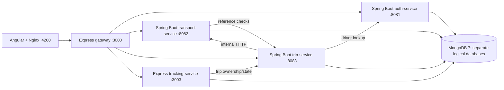

# SmartBus TN — 
A small, layered microservices application for a student demonstration. English Angular web UI, Java 17 / Spring Boot 4.1.1 services, Express services, MongoDB 7, RS256 JWT and Docker Compose.

## Start on Windows

1. Install/start Docker Desktop with Linux containers. No local Java, Node or MongoDB installation is needed for the Docker route.
2. Extract this complete folder. Open PowerShell **inside this folder**.
3. Run:

```powershell
powershell -ExecutionPolicy Bypass -File .\init-env.ps1
powershell -ExecutionPolicy Bypass -File .\start.ps1
```

The first command asks for your own administrator password; typed password characters are hidden. It creates a private `.env` and a random internal service token. The second builds and starts seven containers. First builds download Java/Node/Mongo dependencies and can take several minutes. Later builds reuse caches.

4. Open **http://localhost:4200**. Search is public. Sign in as the administrator using the email/password you chose.
5. In Administration → Drivers, create a driver. In Trips, assign a route, bus, driver and future departure. Sign out and sign in as that driver to start and manage the trip. See [demo steps](docs/DEMO.md).

If ports 4200/3000/27019 are occupied by your previous project, stop that project's containers or change `WEB_PORT`, `API_PORT`, `MONGO_PORT` in this project's `.env`. Then run `docker compose up -d` again. Do not run both projects on the same published ports.

```powershell
docker compose ps                    # container state
docker compose logs -f               # follow logs; Ctrl+C leaves containers running
docker compose logs --tail 80 auth-service
docker compose stop                  # stop, preserving data
docker compose up -d                 # restart unchanged images
docker compose up -d --build         # after changing source files
docker compose down                 # remove containers; keep named volumes
```

**Do not add `-v` to `down` unless you intentionally want to delete this project's database and signing key volumes.** The admin password in `.env` is used only when the admin account is first created; changing `.env` does not change an existing account's password.

## What is included

- **Sprint 1:** citizen registration/login/roles; bus, station and ordered-route CRUD; fare configuration; daily recurring schedules; direct journey search with departure, estimated arrival and fare.
- **Sprint 2:** admin-created drivers and trip assignments; driver-owned start/stop confirmations/finish; active bus map; GPS/manual/simulated location reporting; passenger count and available seats; ETA updates from trip progress.
- Server-side DTO validation, password hashing, role checks, ownership checks, database uniqueness, JSON errors, seed data, source tests and an opt-in integration smoke script.
- No payment processing, QR ticketing, connections/transfers, notifications or real traffic predictions.

## Architecture



Transport owns fares along with buses, stations and routes. This consolidation keeps reference-data management understandable while retaining independently deployable services. Express is used for the gateway and tracking; Spring Boot handles authentication, transport and trips, respecting the latest mixed-framework requirement. All services validate JWTs themselves; gateway checks are additional protection.

## Where to read the code

```text
frontend/src/app/
  core/       API client, models, authentication, interceptor and guard
  pages/      search, login, live map, admin and driver screens
  shared/     Leaflet bus map
services/
  auth-service/src/main/java/tn/smartbus/auth/
  transport-service/src/main/java/tn/smartbus/transport/
  trip-service/src/main/java/tn/smartbus/trip/
    controller/  HTTP endpoints; no database access
    dto/         request validation and response contracts
    service/     business rules and service-to-service calls
    repository/  MongoDB persistence
    mapper/      explicit entity/DTO conversion
    entity/      persisted domain objects
    exception/   application errors and HTTP error handling
    security/    bearer-token and internal-endpoint protection
  tracking-service/src/  same responsibilities in Express modules
  gateway/src/           routing, proxying, security and error handling
```

Gateway has no persisted business data, so it deliberately has no fake Entity/Repository/Mapper layers. This is organization by responsibility rather than adding empty files.

## Data and security

Seed data: Tunis Marine, Le Bardo, Manouba, Ariana; TN-1001 and TN-1002; routes 20 and 5; fares 1.200 and 1.000 TND; 06:00–22:00 daily departures every 20/30 minutes. Schedules describe recurring departures; concrete driver trips are created separately. Search follows station order and includes boarding-stop offsets.

Each business service owns its MongoDB database. One MongoDB container hosts `smartbus_auth`, `smartbus_transport`, `smartbus_trip`, `smartbus_tracking`. MongoDB Compass can connect to `mongodb://localhost:27019` (or your configured `MONGO_PORT`). Databases appear after their first write. Gateway has no database.

JWT lifetime: 30 minutes. RSA private key is generated on first auth start and stored in the `auth-keys` Docker volume. Only public keys are shared through JWKS. Passwords use BCrypt. Public registration cannot create an ADMIN/DRIVER account. The browser holds its token in memory and signs out on refresh/expiry. `.env` and generated keys are ignored and excluded from the source archive. Never share your `.env` with your friend; let them run initialization themselves.

This is a **new implementation with new Docker volumes**. It does not automatically import your earlier project's accounts or data. Your earlier project is unchanged. See [migration notes](docs/MIGRATION.md).

## Optional local development

Requires Java 17, Maven 3.9+, Node 24 and Docker/MongoDB 7. Install dependencies with `npm ci` in `frontend`, `services/gateway` and `services/tracking-service`. Use dedicated development databases.

Start only MongoDB with `docker compose up -d mongo`. In each service terminal, set `INTERNAL_TOKEN` to the same value from your private `.env` (PowerShell does not load `.env` automatically). For auth also set `ADMIN_EMAIL`, `ADMIN_PASSWORD`. Java defaults use localhost ports 8081/8082/8083 and MongoDB 27019. Run `mvn spring-boot:run` inside each Java service folder. Run `npm start` inside each Express service folder; tracking defaults to 3003, gateway to 3000. Run `npm start` in frontend; Angular's proxy forwards `/api` to gateway. Do not run these on ports already used by Compose.

## Verification and documents

After installing local dependencies: `powershell -ExecutionPolicy Bypass -File .\scripts\check.ps1` builds Angular and runs Java/Node tests. The integration script `scripts/smoke.py` creates test accounts/trips in a running application: run it only in an isolated QA environment, with `API_BASE`, `ADMIN_EMAIL`, `ADMIN_PASSWORD` set. It intentionally does not delete accounts/history.

- [Architecture and constraints](docs/ARCHITECTURE.md)
- [REST API reference](docs/API.md)
- [Sprint scope and acceptance criteria](docs/USER-STORIES.md)
- [Demo walkthrough](docs/DEMO.md)
- [Actual verification results](docs/TEST-RESULTS.md)
- [Teacher submission checklist](docs/SUBMISSION.md)

Routes appear in journey search once both their schedule and standard fare are configured. A route without a fare is omitted; service outages still return an error.
